#    C4炸彈安裝拆除模擬器
模擬一個C4炸彈安裝與拆除的專案
##    1.情景故事
此為某款FPS遊戲的C4炸彈，匪徒方輸入**7355608**放置炸彈  
放置炸彈時，**炸彈的紅色燈號閃爍、蜂鳴器運作**  
越靠近炸彈爆炸時會燈號和聲音會閃爍的更快  
警方要阻止炸彈爆炸，如果在爆炸前將炸彈拆除  
炸彈上就會**顯示綠燈，並且紅燈跟蜂鳴器停止運作**  
並且警方如果手上有鉗子，拆除時間會更短   
如果**沒有鉗子，拆除時間是10秒，反之5秒**  
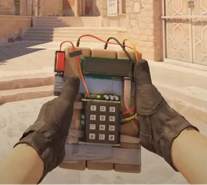  
##    2.腳位對照與思路  
1.使用LPUART1(Baud Rate：115200 , 8N1)在pyserial終端機中輸入文字  
當在**終端機輸入文字”7355608”代表炸彈放置**  
**輸入”CUT”代表你擁有鉗子，拆除速度可以更快。**  
2.使用TIM3 (PWM Generation CH2~4)(PC9 PC8 PA4)(PSC：169 ,ARR：999 ,1ms )  
作為放置炸彈後蜂鳴器鳴叫、紅燈呼吸閃爍、拆炸彈時綠燈進度使用  
3.GPIO_Output (PC6)作為確認是否有”CUT”時使用，如果有就亮燈  
4.GPIO_EXTI(PA11)(Pull-up)中斷程式，作為要拆除炸彈時的按鈕  

--MX設定--  
5.(NVIC EXTI line[15：10] ☑ LPUART1 globle interrupt ☑)  
6.(SYS Debug Serial Wire)  
7.(TIM3 Clock Sourse internal Clock)  
8.(Connectivity Mode Asynchronous)  

--Pyserial設定—  
9.(CMD python -m serial.tools.miniterm --echo COM(你的port號) 115200)  
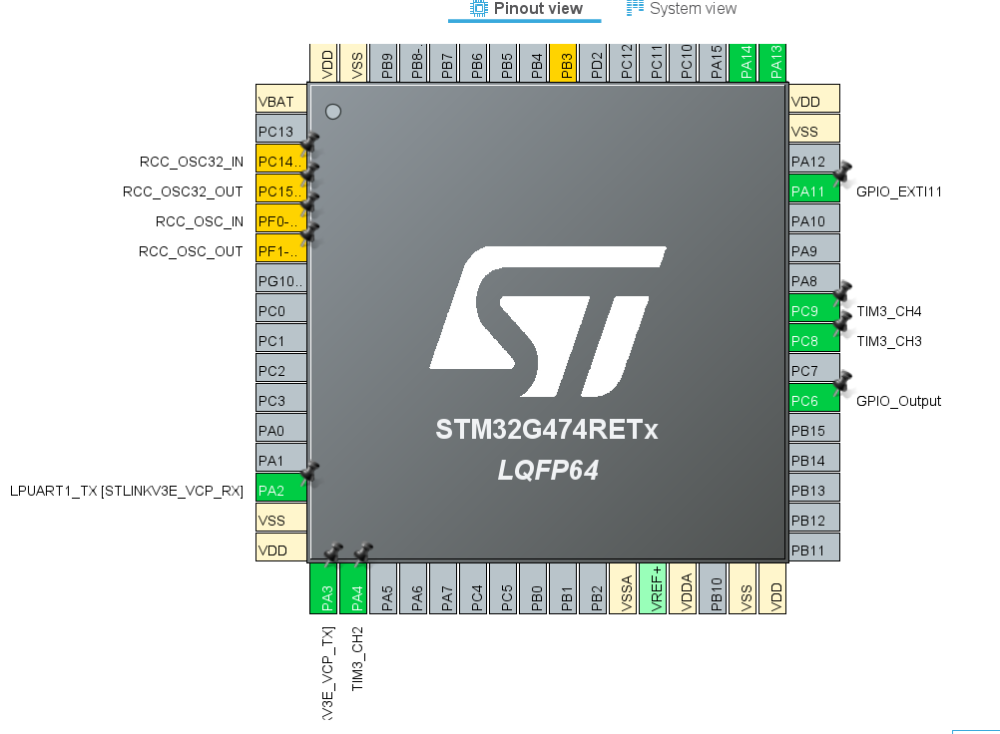  
##    3.驗收條件與結果  
1.打開CMD -> Pyserial 輸入7355608 | 紅燈、蜂鳴器呼吸閃爍並倒數 ☑  
2.在Pyserial 輸入CUT | 黃燈亮起 ☑  
3.按下按鈕 | 進入拆除動作 綠燈開始作為進度條亮起 ☑  
4.拆除過程 | 如果有CUT 拆除時間為5秒，如果沒有為10秒 ☑  
5.拆除完畢 | 綠燈常亮，紅燈及蜂鳴器停止 ☑  
6.炸彈爆炸 | 綠燈關閉，紅燈及蜂鳴器常開 ☑  
7.炸彈爆炸後按按鈕 | 不會有反應，炸彈爆炸後無法拆除 ☑  
8.拆除炸彈後輸入7355608 | 會重新啟動炸彈 ☑  
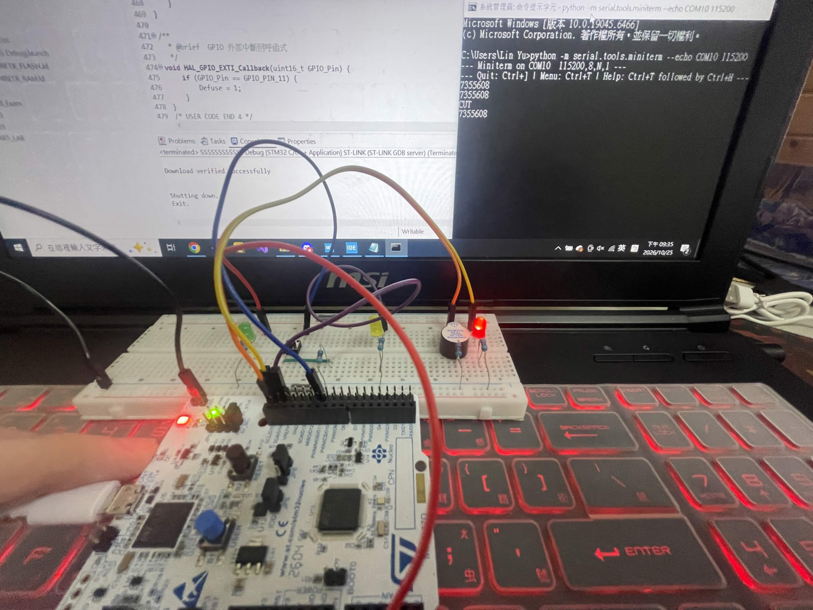  
##    4.C4技術應用勾選表  
☑GPIO輸出 黃燈PC6 MODE=01 判斷是否有鉗子  
☑GPIO輸入 PA11 MODE=00 EXTI來源腳位  
☐複用功能AF   

☑時脈功能 PPL 170MHz  

☑外部中斷 EXTI PC13 一按就準備拆C4  
☑NVIC功能 EXTI line[15:10]  
☐優先權與巢狀 無  
☑軟體去彈跳 按下按鈕拆炸彈時不會誤動作  
  
☐UART 傳送	   
☑UART 接收+環形緩衝 接收7355608 與 CUT  
LPUART1 115200 8N1  
☑Pyserial 在CMD裡面輸入文字傳送給STM32  
python -m serial.tools.miniterm - - echo  
COM10 115200  
  
☐Timer 定時中斷  
☑PWM timer3 PSC169 ARR999 1000Hz  
☐輸入捕捉  
##    5.腳位表  
本次應用到的腳位為  
TIM3_CH2 PA4 綠燈 正在拆炸彈、已經拆除完畢炸彈使用  
TIM3_CH3 PC8 紅燈 安裝炸彈後閃爍使用  
TIM3_CH4 PC9 蜂鳴器 安裝炸彈後鳴叫使用  
GPIO_EXTI11 PA11 按鈕 拆除炸彈時使用  
GPIO_Output PC6 黃燈 判斷是否擁有CUT  
LPUART1_TX_STLINKV3E_VCP_RX PA2 接收給STM32 主機傳輸訊息用  
LPUART1_TX_STLINKV3E_VCP_TX PA2 傳輸給主機 主機接收訊息用  
##    6.建置與執行  
**開發環境**：STM32CubeIDE  
**燒錄步驟**：開啟專案 → 點擊 Build (鎚子圖示) → 點擊 Run / Debug 燒錄至 NUCLEO-G474RE。  
**終端機設定與指令**：  
* 開啟終端機：`python -m serial.tools.miniterm --echo COM(你的com號) 115200`  
  * 支援指令：  
    * `7355608`：啟動拆彈倒數與呼吸燈、蜂鳴器。  
    * `CUT`：執行剪線加速指令。  
##    7.程式結構  
(考試那天記得做)  
##    8.實作照片與講解  
###    8-1.MX設定  
8-1-1.打開STM32CubeMX 設定以下腳位：  
PA11：GPIO_EXTI11 | PC9：TIM3_CH4  
PC8：TIM3_CH3 | PC6：GPIO_Output  
PA4：TIM3_CH2  
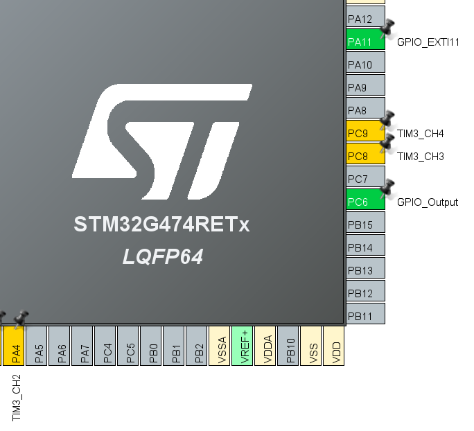  
8-1-2.點選MX左方“System Core”下方的“SYS”  
打開後點擊“Debug”的框  
選擇“Serial Wire  
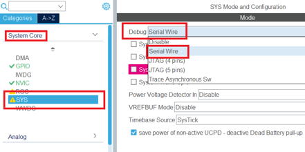   
8-1-3.點選MX左方“Timers”下方的“TIM3”   
打開後點擊“Channel 2,3,4”的框  
選擇“PWM Generation CH2,3,4”  
下方的Preacaler 設定為169  
Counter Period 設定為999  
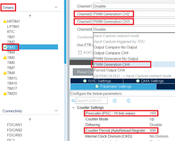  
8-1-4.點選MX左方“Connectivity”下方的“LPUART1”  
打開後點擊“Mode”的框 選擇“Asynchronous”  
下方“Baud Rate”改成“115200 Bit/s”  
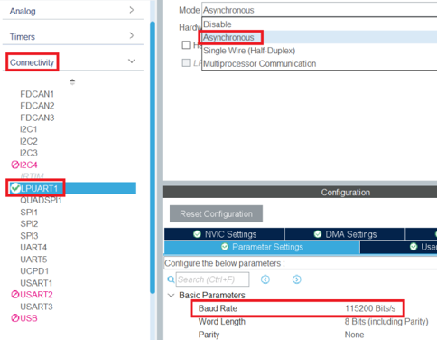  
8-1-5.點選MX左方“System Core”下方的“NVIC”  
將“EXTI line[15：10] interrupts”打勾  
並且將“Preemption Priority”調整為1  
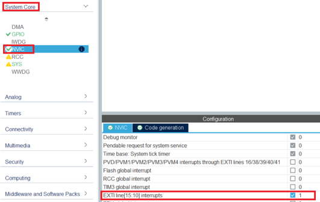  
###    8-2實體配線  
8-2-1.下圖為本次使用接腳的接腳圖，紅色框是 TIM3 的(PA4,PC8,PC9)  
藍色框的是GPIO_EXTI(PA11)、棕色框的是GPIO_Output(PC6)  
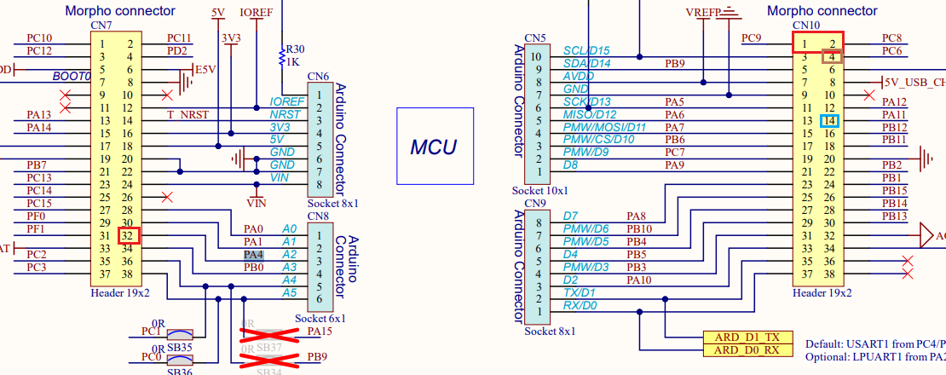  
8-2-2.此頁為接腳實體配線，黑框為GND，為接地使用  
紅框為(TIM3_CH3,4)，提供給麵包版上的紅燈與蜂鳴器使用  
綠框為(TIM3_CH2)，提供給麵包版上的綠燈使用  
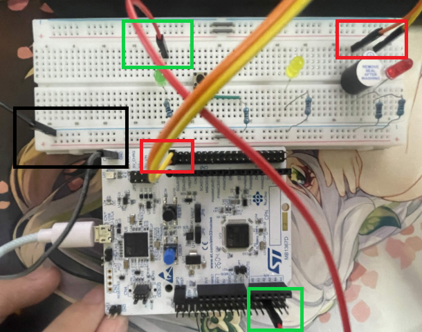  
8-2-3.棕框為GPIO_EXTI11，為麵包版上按鈕按下後讀取訊號使用  
黃框為GPIO_Output，提供給麵包版上的黃燈使用  
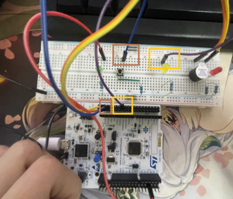  
###    8-3實機操作  
8-3-1.將程式燒錄進STM32後，打開電腦的“裝置管理員”  
查看下方的連接埠，確認自己的STM32在COM幾(此裝置為COM10)  
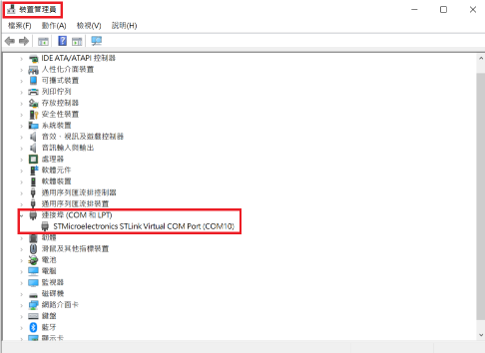  
8-3-2.打開“CMD”後輸入以下字元用來搭建通訊連接  
“python –m serial.tools.miniterm --echo COM10 115200”  
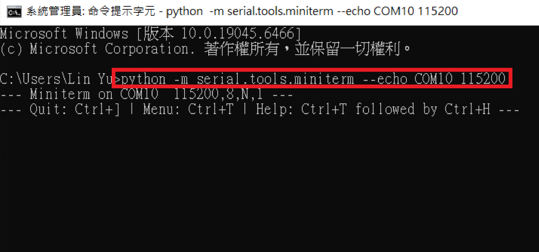  
8-3-3.在CMD內輸入7355608後 可以看見紅燈及蜂鳴器開始閃爍  
到計時，如果到時間結束還是沒有拆除成功，   
紅燈及蜂鳴器會呈現常亮，不會再進行呼吸閃爍   
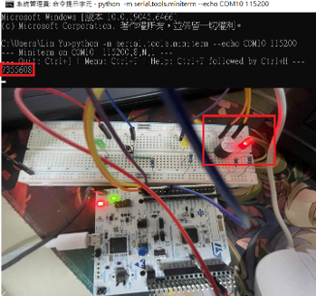   
8-3-4.在CMD內輸入CUT後 可以看見黃燈亮起，判斷是否有鉗子   
如果有可以讓拆除時間減少5秒   
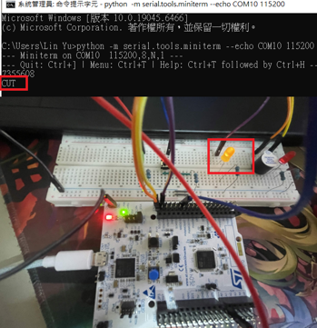    
8-3-5.在按下按鈕後，會進行拆除炸彈動作，綠燈會逐漸亮起   
(黃燈亮起時拆除時間為5秒，反之10秒)   
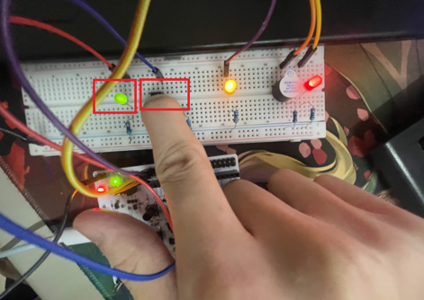   
8-3-6.拆除完畢後，紅燈及蜂鳴器停止運作，綠燈常亮   
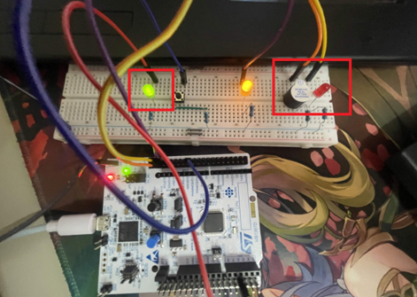   
##    9.AI使用說明   
##    10.已知限制  
因為本次實作與實際上依然相差甚大，例如C4炸彈 主要成分為RDX旋風炸藥 、 而我們需要透過電流讓雷管通電，引爆內部的初級炸藥
而雷管爆炸釋放的高溫與高壓衝擊波，